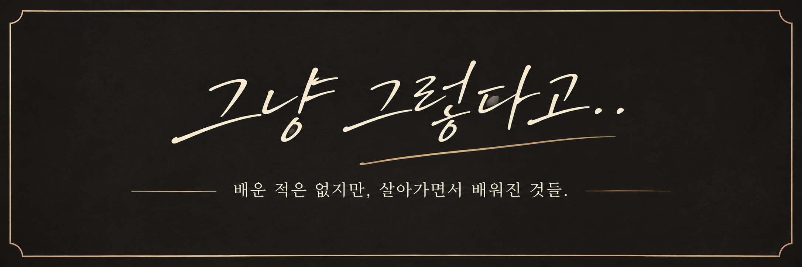

# 그냥 그렇다고..

> 배운 적은 없지만, 살아가면서 배운 것들

## 작성자의 말

27살입니다. 인생을 논하기에는 어리고, 아무것도 모른다고 하기에는 제법 살아왔습니다.

살면서 여러 사람을 만났습니다. 닮고 싶은 사람도 있었고, 저렇게는 살지 말아야겠다고 생각하게 만든 사람도 있었습니다.

그렇게 하나둘 나름의 기준이 생겼습니다.

누가 따로 가르쳐준 적은 없습니다. 보고, 듣고, 겪고, 때로는 실수하면서 배워진 것들입니다.

대단한 이야기는 아닙니다. 대부분 몇 초의 시간과 약간의 수고, 가끔은 몇천 원이면 지킬 수 있는 것들입니다.

그런데 그 사소한 것들이 모여 사람의 인상을 만든다고 생각합니다.

## 읽어보기

### [100가지 잔소리 읽으러 가기 →](RULES.md)

## 여덟 개의 주제

| 장  | 주제                                                                 |  항목  |
| :-: | -------------------------------------------------------------------- | :----: |
| 01  | [첫인상과 기본 예절](RULES.md#01-첫인상과-기본-예절)                 |  1–15  |
| 02  | [대화와 말의 태도](RULES.md#02-대화와-말의-태도)                     | 16–34  |
| 03  | [감사와 호의](RULES.md#03-감사와-호의)                               | 35–44  |
| 04  | [돈과 식사 예절](RULES.md#04-돈과-식사-예절)                         | 45–54  |
| 05  | [남의 공간·물건·차를 대할 때](RULES.md#05-남의-공간물건차를-대할-때) | 55–64  |
| 06  | [관계와 경계](RULES.md#06-관계와-경계)                               | 65–79  |
| 07  | [일과 조직생활](RULES.md#07-일과-조직생활)                           | 80–92  |
| 08  | [감정 조절과 책임](RULES.md#08-감정-조절과-책임)                     | 93–100 |

## 이 글에 대하여

인생의 정답도, 특정 세대에 대한 평가도 아닙니다. 제가 살아가며 겪은 일과 그때 생긴 기준을 적었습니다.

저도 여기 적힌 모든 것을 완벽하게 지키지는 못합니다. 시간이 지나 생각이 달라지면 고치고, 더 배운 것이 생기면 추가할 겁니다.

---

### 이정도는 하고 살자

```
돈을 아낄 줄도, 쓸 줄도 알아야지.

얻어먹었으면 커피라도 사야지.

기분이 나쁘다고 태도까지 나빠지면 안 되지.

친하다고 예의를 없애면 안 되지.

나이가 어리다고 언제까지 어린애처럼 살 건데.
```

대단한 이야기는 아닙니다.

대부분 몇 초의 시간과 약간의 수고, 가끔은 몇천 원이면 지킬 수 있는 것들입니다.

## 그런데 그 사소한 것들이 모여 사람의 인상을 만든다고 생각합니다.

꼰대라고요?

그럴 수도 있습니다.

근데 예의 바르고, 고마움을 알고, 주변 사람을 챙겨서 나쁠 건 없지 않습니까?

뭐, 그냥 그렇다고요.
