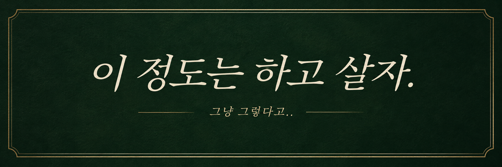

# 그냥 그렇다고..

## 목차

- [01. 첫인상과 기본 예절](#01-첫인상과-기본-예절)
- [02. 대화와 말의 태도](#02-대화와-말의-태도)
- [03. 감사와 호의](#03-감사와-호의)
- [04. 돈과 식사 예절](#04-돈과-식사-예절)
- [05. 남의 공간·물건·차를 대할 때](#05-남의-공간물건차를-대할-때)
- [06. 관계와 경계](#06-관계와-경계)
- [07. 일과 조직생활](#07-일과-조직생활)
- [08. 감정 조절과 책임](#08-감정-조절과-책임)

---

## 01. 첫인상과 기본 예절

> 몇 초면 되는 걸 굳이 안 할 이유는 없잖아.

### 1. 웃는 모습을 많이 보이자.

> 무의식 중에 "이 사람은 잘 웃는 사람이다"라는 인식을 심어주자. 긍정적인 이미지라 나쁠 건 없다.

### 2. 신발장에 신발 벗어놓을 때는 바로 신고 나갈 수 있게 벗어놔라

> 물론 신발을 벗고 바로 들어갈 수 있다. 근데 그거 나갈 때 바로 신을 수 있게 정리하는거 몇 초 안 걸린다.
>
> 그 몇 초로 젠틀한 인상을 만들어낼 수 있다. 시간 여유가 되면 남들 신발 정리도 좀 해줘라.

### 3. 손글씨 연습해라

> 요즘 손글씨 안 쓴다고는 하지만, 글씨 잘 써서 안 좋을 거 없다. 때론 아날로그가 주는 전문적인 이미지가 있다.

### 4. 젓가락질 연습해라.

> 손글씨랑 마찬가지로, 먹는데 지장없으면 상관없다는 사람들 있다. 젓가락질 잘해서 안 좋을 거 없다. 안 좋게 볼 사람들은 안 좋게 본다.
>
> 그 사람들한테 안 좋은 이미지로 찍히기 싫어서 그런거다. 할 사람은 해라.

### 5. 인사 잘하고 다니자

> 출근하거나 퇴근할 때 "안녕하세요, 안녕히 계세요"는 하고 다니자.
>
> 잘 모르는 사람을 마주쳐도 같은 직장이라면 목례는 하자.

### 6. 먼저 엘리베이터 탔으면 열림 버튼 좀 계속 눌러줘라.

> 내가 엘리베이터 먼저 타고 있으면, 사람들이 모두 타거나 내릴 때까지 '열림'버튼 좀 눌러줘라.

### 7. 압존법 없어졌다고 하지만 부르면 좋아하더라

> 압존법이란게 높여 부르는 법인데, 없애는 추세라고 해도 하면 좋아함.

### 8. 전화 걸고 바로 용건부터 시작하지 마라

> 전화를 걸었으면 "여보세요?"나 내가 누군지는 밝히고 통화해라.
>
> 누군지도 모르는 사람이랑 통화하기 싫고, 용건만 띡 이야기하면 예의없어 보인다.

### 9. 약속 시간에 도착하지 말고 약속 시간 전에 도착해라.

> 약속 시간은 준비를 마치고 상대를 만나는 시간이지, 목적지에 도착하는 시간이 아니다. 5분이라도 일찍 도착하는 습관을 들여라.
>
> 상대방 시간도 자산이다.

### 10. 청결은 본인만을 위한 것이 아니다.

> 구취, 체취, 손톱, 옷의 오염 상태 등을 신경 써라. 비싼 옷을 입는 것보다 깨끗하게 관리된 모습을 보여주는 게 먼저다.

### 11. 아무도 보지 않을 때도 예의를 지켜라.

> 누가 볼 때만 쓰레기를 줍고, 누가 볼 때만 친절하게 행동하지 마라.
>
> 이미지로 시작한 행동이라도 습관이 되면 결국 그게 네 인격이 된다.

### 12. 문을 열고 들어갈 때 뒤에 사람 있는지 확인해라.

> 뒤에 사람이 따라오고 있으면 문을 잠깐 잡아줘라.
>
> 몇 초도 걸리지 않는 행동이다.
>
> 모르는 사람에게도 자연스럽게 배려하는 습관을 들여라.

### 13. 사람을 기다리게 했으면 뛰어오는 시늉이라도 해라.

> 늦어놓고 여유롭게 걸어오지 마라.
>
> 기다린 사람에게 미안해하는 태도라도 보여줘라.
>
> 물론 가장 좋은 건 늦지 않는 거다.

### 14. 상대방의 이름을 기억해라.

> 한 번 소개받은 사람의 이름 정도는 기억하려고 노력해라.
>
> 오랜만에 만났는데도 이름을 기억하고 불러주는 것만으로 상대방에게 좋은 인상을 줄 수 있다.

### 15. 사소한 일에도 준비성이 있는 사람이 돼라.

> 비가 온다면 우산을 챙기고, 장거리 여행이라면 충전기를 챙겨라.
>
> 매번 준비하지 않고 남에게 빌리는 것을 습관으로 만들지 마라.
>
> 본인의 편의를 남의 준비성에 의존하지 마라.

[↑ 목차로 돌아가기](#목차)

---

## 02. 대화와 말의 태도

> 입 밖으로 내뱉기 전에 한 번만 더 생각해라.

### 16. 모르면 입 다물자

> 알면 아는대로 이야기하고, 모르면 모른다고 이야기하자.
>
> 애매하게 아는 척 하면 같이 있는 사람들만 헷갈린다.

### 17. 없는 사람 이야기는 웬만하면 좋게 해라.

> 같이 있는 사람에게 누군가의 뒷담화를 하면, 그 사람도 본인이 없는 자리에서 니가 무슨 말을 할지 생각하게 된다.
>
> 반대로 없는 사람을 좋게 이야기하면 신뢰를 얻을 수 있다.

### 18. 남의 자랑에 굳이 초 치지 마라.

> 누군가 좋은 일이 있어서 자랑하면 그냥 축하해 줘라. 네가 더 좋은 것을 가지고 있던, 별것 아닌 일이라고 생각하든 굳이 이야기할 필요 없다.
>
> 상대방의 기쁨을 인정해 주는 데 돈 드는 거 아니다.

### 19. 공개적인 자리에서 남을 무안하게 만들지 마라

> 상대방이 틀린 말을 하거나 실수하더라도 당장 바로잡아야 하는 상황이 아니라면 따로 이야기해라.
>
> 잘못을 알려주는 것과 사람의 체면을 깎는 것은 다르다

### 20. 칭찬은 공개적으로, 지적은 개인적으로 해라

> 칭찬은 여러 사람이 있는 자리에서 해주고, 부족한 점은 따로 불러서 이야기해라.
>
> 같은 내용이라도 전달하는 방식에 따라 받아들이는 태도가 달라진다.

### 21. 상대방이 말 할 때 휴대폰 좀 내려놔라.

> 급한 연락이 있는 게 아니라면 눈앞에 있는 사람에게 집중해라.
>
> 시간을 내어 만났는데 휴대폰만 보고 있으면 상대방은 본인이 중요하지 않은 사람이라고 느낄 수 있다.

### 22. 농담으로라도 사람의 자존심을 건드리지 마라.

> 외모, 경제력, 학벌, 가정환경 등을 가지고 웃기려고 하지 마라.
>
> 상대방이 같이 웃었다고 해서 기분이 나쁘지 않았다는 뜻은 아니다.

### 23. 회의나 모임에서 말하지 않는 사람도 챙겨라.

> 말을 많이 하는 사람들끼리만 이야기하지 마라. 소외된 사람이 있으면 자연스럽게 대화에 참여할 수 있도록 질문을 던져줘라.
>
> 주변을 살필 줄 아는 것도 능력이다.

### 24. 상대방이 민망해할 때는 모른 척할 줄도 알아야 한다.

> 사람이 살다 보면 실수하거나 민망한 상황에 놓일 때가 있다.
>
> 그걸 알아챘다고 굳이 티 내거나 언급하지 마라.
>
> 때로는 알아도 모르는 척, 봐도 못 본 척해주는 것이 상대방의 체면을 지켜주는 배려다.

### 25. 남의 물건을 평가하지 마라.

> 누군가 새로 산 옷이나 차, 전자기기를 보여주면 굳이 단점을 찾아서 이야기하지 마라.
>
> 이미 돈 주고 산 물건인데 네가 부정적으로 평가한다고 달라질 건 없다.

### 26. 남이 무엇을 먹든 참견하지 마라.

> 그걸 왜 먹냐, 맛없지 않냐, 살찌지 않냐는 이야기를 굳이 하지 마라.
>
> 본인이 먹고 싶은 걸 먹는 데 네 평가까지 받아야 할 이유는 없다.

### 27. 상대방의 말을 끝까지 들어라.

> 무슨 말을 할지 알겠다고 중간에 끊지 마라.
>
> 네가 알고 있는 내용이라도 상대방은 본인의 이야기를 끝까지 하고 싶을 수 있다.
>
> 대화는 지식을 경쟁하는 자리가 아니다.

### 28. 조언을 구하지 않았으면 굳이 조언하지 마라.

> 상대방이 힘들다고 이야기하는 이유가 반드시 해결책을 듣고 싶어서인 것은 아니다.
>
> 본인이 더 잘 안다는 생각으로 남의 인생에 훈수 두지 마라.

### 29. 처음 만난 사람에게 사적인 질문을 많이 하지 마라.

> 연봉, 재산, 연애, 결혼, 가정환경 같은 이야기는 상대방이 먼저 꺼낼 때까지 기다려라.
>
> 네 호기심을 해결하기 위해 상대방을 불편하게 만들지 마라.

### 30. 누군가의 실수를 두고두고 이야기하지 마라.

> 이미 사과하고 해결된 일을 술자리나 모임에서 반복해서 꺼내지 마라.
>
> 네게는 재미있는 이야기일지 몰라도 상대방에게는 다시 겪고 싶지 않은 일일 수 있다.

### 31. 단체 모임에서 둘만 아는 이야기만 하지 마라.

> 여럿이 모인 자리에서 특정 사람과만 공유하는 이야기로 대화를 이어가지 마라.
>
> 같이 있는 사람들이 모두 참여할 수 있는 이야기를 해라.

### 32. 남의 취향을 무시하지 마라.

> 네가 좋아하지 않는 음악, 영화, 옷, 취미라고 해서 수준이 낮은 것은 아니다.
>
> 취향이 다른 것과 수준이 다른 것을 구분해라.

### 33. 잘못된 정보는 알게 된 즉시 정정해라.

> 네가 잘못 알려준 정보라는 것을 알게 됐으면 먼저 연락해서 정정해라.
>
> 민망하다고 가만히 있지 마라.
>
> 잘못을 인정하는 것보다 잘못된 정보를 방치하는 것이 더 무책임하다.

### 34. 사람을 대할 때 이전 사람과 비교하지 마라.

> 전 직장에서는 이랬는데, 전 연인은 이랬는데, 다른 친구는 이랬는데라는 말을 습관적으로 하지 마라.
>
> 지금 네 앞에 있는 사람은 그 사람들과 다른 사람이다.

[↑ 목차로 돌아가기](#목차)

---

## 03. 감사와 호의

> 고마운 건 고마운 거다. 당연한 건 없다.

### 35. 미안함과 고마움은 한 번으로 끝내지 말자

> '미안해'와 '고마워'는 최소 3번은 하자. 당사자에게 진심이 전달될 것이다.

### 36. 남의 호의를 당연하게 생각하지 마라

> 한 번 베풀어준 사람이 두 번, 세 번 베풀어준다고 해서 그게 그 사람의 의무가 되는 건 아니다. 반복되는 호의에도 처음과 같은 고마움을 표현해라.

### 37. 도움받은 일의 결과를 알려줘라.

> 누군가 조언을 해주거나 문제를 해결해 줬으면 이후에 어떻게 됐는지 알려줘라.
>
> 덕분에 잘 해결됐다는 말 한마디가 상대방에게도 보람이 된다.

### 38. 선물을 받았으면 사용했다는 이야기도 해줘라.

> 선물을 받는 순간 고맙다고 하는 것도 중요하지만, 나중에 잘 쓰고 있다는 말이나 사진 한 장을 보내줘라.
>
> 선물을 고르느라 고민했던 사람에게 좋은 답례가 된다.

### 39. 모든 호의에 대가를 기대하지 마라.

> 좋은 인상을 남기기 위해 호의를 베푸는 것도 나쁘지 않다.
>
> 다만 상대방이 그만큼 돌려주지 않았다고 서운해할 거면 처음부터 베풀지 마라.

### 40. 본인이 베푼 것은 잊고 받은 것은 기억해라.

> 내가 누구에게 얼마를 썼고 무엇을 해줬는지 일일이 기억하며 생색내지 마라.
>
> 반대로 내가 받은 도움은 기억해 두었다가 상대방이 필요할 때 돌려줘라.

### 41. 경조사는 가능한 한 챙겨라.

> 기쁜 일에 함께해 주는 것도 중요하지만 힘든 일에 함께해 주는 것도 중요하다.
>
> 직접 방문하기 어렵다면 연락이라도 해라.
>
> 특히 힘든 시기에 찾아와 준 사람은 오래 기억에 남는다.

### 42. 사람을 만나러 갈 때 빈손인 게 습관이 되지 마라.

> 오랜만에 만나는 사람이나 고마운 사람을 만나러 갈 때는 작은 간식이라도 챙겨봐라.
>
> 가격이 중요한 게 아니라 그 사람을 생각하고 준비했다는 사실이 중요하다.

### 43. 자리를 마련한 사람에게 고마움을 표현해라.

> 모임 장소를 알아보고, 예약하고, 사람들의 일정을 조율하는 것도 일이다.
>
> 모임이 끝나면 자리를 준비한 사람에게 수고했다는 말이라도 해라.

### 44. 인간관계를 손익계산서처럼 관리하지 마라.

> 내가 얼마나 해줬고 상대방이 얼마나 해줬는지 매번 계산하지 마라.
>
> 모든 관계가 항상 동일한 비율로 주고받을 수는 없다.
>
> 서로의 상황과 여유가 다르다는 것을 이해해라.

[↑ 목차로 돌아가기](#목차)

---

## 04. 돈과 식사 예절

> 돈이 많아야 하는 게 아니라 쓸 줄 알아야 한다.

### 45. 돈은 쓸 땐 쓰자.

> 요즘 시대 돈 아끼는 것도 중요하지만, 베풀 줄 아는 것도 중요하다. 돈으로 신뢰와 이미지를 구할 수 있을 뿐더라, 여유있는 사람으로 보인다.
>
> 돈을 쓸 수 없는 상황이 있을 수 있다. 그 때는 그럴듯한 이유라도 설명해라.

### 46. 밥 얻어먹었으면 커피라도 사라

> 상사나 나이 많은 지인, 친척, 동료라도 밥을 얻어먹었으면 커피라도 사자. 고마움을 아는 사람으로 인식된다.

### 47. 얻어먹는 사람이 메뉴 가격을 올리지 마라.

> 누군가 밥을 사준다고 하면 상대방이 정한 가격대 안에서 골라라.
>
> 먹고 싶은 게 있으면 네 돈으로 사 먹으면 된다.

### 48. 단체로 밥 먹을 때 수저라도 놔라.

> 가만히 앉아서 누군가 해주기를 기다리지 마라.
>
> 수저를 놓거나 물을 따라주는 것 정도는 누구나 할 수 있다.
>
> 사소한 행동에서 평소에 어떻게 살아왔는지가 드러난다.

### 49. 돈 빌렸으면 달라고 하기 전에 갚아라.

> 돈을 빌려준 사람이 먼저 돈 이야기를 꺼내게 하지 마라.
>
> 돈을 빌려준 사람이 오히려 불편해지는 상황을 만들지 마라.
>
> 약속한 날짜에 갚기 어렵다면 먼저 연락해라.

### 50. 남의 음식에 손대기 전에 물어봐라.

> 친하다고 남의 음식을 마음대로 가져다 먹지 마라.
>
> 한 입 먹어봐도 되냐고 물어보는 데 몇 초 안 걸린다.
>
> 사소한 소유권도 존중해라.

### 51. 남의 경제적 상황을 함부로 판단하지 마라.

> 비싼 물건을 산다고 돈이 많은 것도 아니고, 저렴한 물건을 산다고 돈이 없는 것도 아니다.
>
> 남이 어떻게 돈을 쓰든 네 돈이 아니라면 함부로 평가하지 마라.

### 52. 정산 연락이 오면 바로 보내라.

> 누군가 먼저 결제하고 정산까지 해줬으면 가능한 한 바로 돈을 보내라.
>
> 그 사람이 여러 번 연락해서 돈을 받아내게 하지 마라.

### 53. 돈이 없더라도 없어 보이려고 하지 마라.

> 비싼 물건을 사라는 이야기가 아니다.
>
> 돈 때문에 매번 불평하거나 남이 돈을 써주기만을 기다리지 마라.
>
> 경제적인 여유와 태도의 여유는 별개다.

### 54. 돈이 있다고 티 내려고 하지 마라.

> 굳이 물건의 가격을 이야기하거나 남의 소비 수준과 비교하지 마라.
>
> 경제적인 여유는 자랑할 때보다 필요한 순간에 자연스럽게 행동할 때 더 잘 드러난다.

[↑ 목차로 돌아가기](#목차)

---

## 05. 남의 공간·물건·차를 대할 때

> 네 것이 아니잖아.

### 55. 집에 초대를 받으면 그 집의 룰을 따라라

> 집에 초대를 받으면 그 집에서 정한 규칙을 손님이 지켜야 한다. 같이 사는 게 아니라면 집 주인이 정한 아주 사소한 규칙도 지켜주는 게 예의다.

### 56. 처음 집에 초대를 받으면 작은 선물이라도 하나 챙겨가라.

> 집 주인은 너를 맞이하기 위해 청소, 빨래, 요리를 준비했을 것이다.(안 했어도 했다는 마인드를 가져라)
>
> 답례의 의미로 처음 누군가의 집에 방문한다면 집 앞 마트에서 음료수라도 사서 가라.

### 57. 남에 차의 탈 떈 신발 털고 타라

> 신발이나 옷에 뭐가 많이 묻었으면 눈치껏 털고 타라. 차도 남의 자산이다.

### 58. 차를 탈 때도 자리 순서가 있다.

> 니가 막내고 운전할 수 있으면 운전해라. 그 다음 조수석이고, 운전석 뒷자리, 조수석 뒷자리다.
>
> 조수석 뒷자리는 제일 상석이다. 비어있어도 니보다 높은 사람 있으면 앉지마라.
>
> 지인이 운전한다면 조수석에 앉아 동행하는 것이 오히려 예의일 수 있다.

### 59. 빌린 물건은 빌릴 때보다 좋은 상태로 돌려줘라.

> 차를 빌렸으면 기름이라도 채워주고, 옷을 빌렸으면 깨끗하게 정리해서 돌려줘라.
>
> 그래야 다음에도 기꺼이 빌려준다.

### 60. 남의 차를 얻어 타면 비용을 생각해라.

> 운전하는 사람은 기름값뿐만 아니라 시간과 체력도 쓰고 있다.
>
> 주차비나 톨게이트 비용이라도 내거나 커피라도 사줘라. 같은 방향으로 간다고 해서 공짜인 것은 아니다.

### 61. 자리를 떠날 때 흔적을 정리해라.

> 식당, 회의실, 카페, 남의 집에서 사용한 자리는 어느 정도 정리하고 나와라.
>
> 치워주는 사람이 따로 있다고 해서 일부러 일을 만들어 줄 필요는 없다.

### 62. 남의 집에서 냉장고를 함부로 열지 마라.

> 아무리 친한 사이라도 남의 집은 남의 공간이다.
>
> 냉장고, 서랍, 방문을 열기 전에 허락을 구해라.
>
> 친밀함과 사생활은 별개다.

### 63. 남의 차에서 잠들지 않으려고 노력해라.

> 특히 장거리 운전이라면 운전하는 사람이 심심하지 않도록 이야기도 걸어주고 주변 상황도 살펴줘라.
>
> 운전할 수 없는 상황이라면 다른 방식으로라도 도움을 줘라.

### 64. 얻어 타는 차는 네가 있는 곳으로 부르지 마라.

> 차를 얻어 타기로 했으면 운전하는 사람의 동선에 맞춰 움직여라.
>
> 태워주는 사람이 네 편의까지 전부 고려해야 할 이유는 없다.

[↑ 목차로 돌아가기](#목차)

---

## 06. 관계와 경계

> 친하다는 이유로 선을 넘지 마라.

### 65. 갈등에 다른 사람 불러들이지 마라

> 누군가와 1대1로 갈등이 벌어지면, 너네 둘이서 해결해라. 공감받는다는 척 편 가르기 하지 마라.

### 66. 사람을 소개받으면 소개해 준 사람의 체면을 생각해라.

> 누군가 너에게 사람을 소개해 준다는 건 본인의 신뢰를 어느 정도 담보로 내어주는 행위다. 네 행동으로 소개해 준 사람이 민망해지는 상황은 만들지 마라.

### 67. 사람에 따라 예의의 수준을 바꾸지 마라

> 상사에게는 깍듯하면서 후배나 직원에게는 함부로 대하지 마라.
>
> 사람들은 네가 윗사람을 대하는 모습뿐만 아니라 아랫사람을 대하는 모습도 보고 있다.

### 68. 친해졌다고 예의를 생략하지 마라.

> 친해질수록 고맙다는 말과 미안하다는 말을 생략하는 사람들이 있다.
>
> 오히려 오래 보고 싶은 사람일수록 기본적인 예의를 지켜라. 친밀함은 무례함에 대한 허가가 아니다.

### 69. 좋은 사람과 만만한 사람을 구분해라.

> 배려할 줄 아는 것과 모든 요구를 들어주는 것은 다르다. 부당한 요구에는 거절할 줄 알아야 한다.
>
> 예의를 지키면서도 단호할 수 있다.

### 70. 남이 알려준 비밀을 친밀함의 수단으로 쓰지 마라.

> 다른 사람과 친해지기 위해 누군가의 개인적인 이야기를 풀어놓지 마라.
>
> 너를 믿고 이야기한 사람의 신뢰를 팔아서 새로운 관계를 만드는 행동이다.

### 71. 부탁할 때는 상대방에게 선택권을 줘라.

> 부탁하면서 거절하기 어려운 분위기를 만들지 마라.
>
> 상대방이 거절할 수 있어야 부탁이지, 거절할 수 없다면 강요에 가깝다.

### 72. 사람들 앞에서 연인을 깎아내리지 마라.

> 친구나 지인들 앞에서 연인의 단점이나 실수를 이야기하며 웃음거리로 만들지 마라.
>
> 네가 선택한 사람의 체면을 지켜주는 것도 네가 해야 할 일이다.

### 73. 단체 사진을 올릴 때는 다른 사람도 생각해라.

> 너만 잘 나온 사진이라고 무작정 올리지 마라.
>
> 다른 사람이 이상하게 나왔거나 공개되기 싫어할 수도 있다.
>
> 남의 얼굴을 공개하는 것도 허락이 필요한 일이다.

### 74. 사람마다 친해지는 속도가 다르다는 것을 알아라.

> 네가 친근하게 대한다고 상대방도 같은 정도의 친밀함을 느끼는 것은 아니다.
>
> 반말이나 장난, 신체 접촉도 상대방과의 관계를 고려해서 해라.

### 75. 사람의 단점만 기억하지 마라.

> 누군가에게 서운한 일이 생겼다고 그동안 그 사람이 해준 좋은 행동까지 부정하지 마라.
>
> 한 번의 행동으로 사람의 모든 것을 판단하지 마라.

### 76. 네 기준을 남에게 강요하지 마라.

> 네가 예의를 중요하게 생각하고 부지런하게 살아가는 것은 좋은 일이다.
>
> 그렇다고 모든 사람이 네 기준대로 살아야 하는 것은 아니다.
>
> 본인에게 엄격하되 타인에게는 여유를 가져라.

### 77. 모든 사람에게 좋은 사람으로 남으려고 하지 마라.

> 아무리 예의 바르고 친절하게 행동해도 너를 싫어하는 사람은 있을 수 있다.
>
> 네가 잘못한 것이 없다면 모든 사람의 평가를 바꾸려고 애쓰지 마라.

### 78. 사람의 약점을 협상 수단으로 쓰지 마라.

> 친한 사이에서 알게 된 약점이나 과거의 실수를 갈등이 생겼을 때 무기로 사용하지 마라.
>
> 한 번 그렇게 행동하면 상대방은 다시는 너에게 솔직해지지 않을 것이다.

### 79. 예의를 지켰다는 이유로 우월감을 갖지 마라.

> 네가 남들보다 예의를 잘 지킨다고 해서 남들보다 좋은 사람이라고 단정하지 마라.
>
> 예의는 상대방을 존중하기 위해 갖추는 것이지, 상대방을 평가하고 깎아내리기 위해 갖추는 것이 아니다.

[↑ 목차로 돌아가기](#목차)

---

## 07. 일과 조직생활

> 혼자 일하는 게 아니잖아.

### 80. 조직 내에서 일 할 땐 니 일 내 일 나누지 마라

> 조직의 이유는 "같이"일해서 시너지를 내라고 모아둔거다. 니 일 내 일 나눌거면 조직 단결력만 떨어뜨린다.
>
> 조직에 방향성과 이득을 고려해서 내가 아닌 조직의 관점에서 일을 해보자.

### 81. 사소한 약속도 지켜라

> 나중에 연락하겠다, 알아봐 주겠다, 보내주겠다는 말도 약속이다.
>
> 지키지 못할 거면 애초에 말하지 마라. 신뢰는 거창한 약속보다 사소한 약속에서 쌓인다.

### 82. 거절할 거면 빨리 거절해라

> 상대방을 실망시키기 싫어서 답변을 미루지 마라. 네 답변을 기다리느라 상대방이 다른 선택지를 놓칠 수도 있다.
>
> 정중하고 명확한 거절도 배려다.

### 83. 일을 못 끝낼 것 같으면 미리 이야기해라.

> 마감 시간이 다 돼서 못 끝냈다고 하지 마라.
>
> 미리 공유하면 다른 사람이 대비하거나 도와줄 수 있다.
>
> 능력 부족보다 예측할 수 없는 사람이 조직에서 부담스럽다.

### 84. 질문할 때 최소한의 노력은 하고 질문해라

> 조금만 찾아보면 알 수 있는 내용까지 남에게 묻지 마라.
>
> 어디까지 알아봤고 무엇을 모르겠는지 정리해서 질문해라. 상대방의 지식뿐만 아니라 시간도 빌리는 행위다.

### 85. 공용 물건을 다 썼으면 채워놔라.

> 휴지, 생수, 커피, 사무용품 등 공용 물건을 마지막으로 사용했으면 채워놔라.
>
> 누군가는 어차피 채우겠지라는 생각을 하지 마라.
>
> 그 누군가가 네가 되면 된다.

### 86. 자리에 없는 사람의 공도 챙겨줘라.

> 여러 사람이 함께 만든 결과물을 네가 대표로 설명하게 될 수 있다.
>
> 그때 함께 고생한 사람들의 기여도 이야기해라.
>
> 남의 공을 인정한다고 네 공이 작아지는 건 아니다.

### 87. 보고할 때는 결론부터 이야기해라.

> 상대방이 궁금해하는 것이 무엇인지 생각하고 이야기해라.
>
> 결과, 현재 상황, 필요한 조치를 먼저 말하고 세부적인 과정은 그다음에 설명해라.
>
> 말을 잘하는 것도 상대방의 시간을 아껴주는 일이다.

### 88. 직급이 낮다고 의견까지 가볍게 보지 마라.

> 경력이 많다고 모든 것을 잘 아는 것도 아니고, 경력이 적다고 모든 것을 모르는 것도 아니다.
>
> 누가 이야기했는지보다 무엇을 이야기했는지를 봐라.

### 89. 퇴근한 사람에게 연락할 때는 한 번 더 생각해라.

> 지금 당장 해결해야 하는 일인지 내일 이야기해도 되는 일인지 구분해라.
>
> 네가 지금 일하고 있다고 다른 사람도 일해야 하는 것은 아니다.

### 90. 할 수 없는 일까지 할 수 있다고 하지 마라.

> 좋은 평가를 받고 싶어서 무리하게 약속하지 마라.
>
> 일을 맡는 순간의 좋은 인상보다 일을 끝내지 못했을 때의 나쁜 인상이 더 오래간다.

### 91. 잘하는 사람을 시기하지 말고 관찰해라.

> 너보다 일을 잘하거나 인간관계가 좋은 사람이 있으면 무엇이 다른지 살펴봐라.
>
> 그 사람의 단점을 찾아내는 것보다 장점을 하나라도 배우는 것이 네 인생에 더 이득이다.

### 92. 본인이 고생했다고 남도 고생해야 한다고 생각하지 마라.

> 네가 불편하게 배웠다고 후배도 불편하게 배워야 하는 것은 아니다.
>
> 본인이 겪었던 불합리함을 다음 사람에게 물려주지 마라.

[↑ 목차로 돌아가기](#목차)

---

## 08. 감정 조절과 책임

> 나이가 어린 거지, 어린애는 아니잖아.

### 93. 감정을 숨길 줄 알아야한다.

> 성인이라면 응당 본인이 해결해야 되는 부분이 있고, 초등학생이 아닌지라 자기 감정을 얼추는 추스려야 하는데
>
> 아프면 아프다, 힘들면 힘들다 이거를 일차원적으로 드러낼 필요는 없다. 성인이라면 응당 본인이 감내해라.
>
> \- 통닭천사

### 94. 사과할 때 상대방의 잘못을 끌고 오지 마라

> 미안하다고 하면서 '근데 너도'라는 말을 붙이지 마라.
>
> 네 잘못에 대한 사과와 상대방의 잘못에 대한 이야기는 별개의 문제다.

### 95. 기분이 나쁘다고 말투까지 나빠지지 마라.

> 네 기분이 나쁜 것과 상대방에게 불친절하게 대하는 것은 별개다.
>
> 본인의 기분을 이유로 다른 사람에게 감정적인 비용을 부담시키지 마라.

### 96. 술을 마셨다는 것을 면죄부로 삼지 마라.

> 술을 마시고 한 말과 행동도 결국 네가 한 거다.
>
> 기억이 나지 않는다고 상대방이 받은 피해까지 없어지는 건 아니다.
>
> 본인이 감당할 수 있는 만큼만 마셔라.

### 97. 지적받았을 때 표정 관리도 해라.

> 부족한 부분을 알려주는 사람 앞에서 인상을 쓰거나 불만스러운 표정을 짓지 마라.
>
> 부당한 지적이라면 근거를 가지고 이야기해라.
>
> 감정적인 반응만 보이면 다음부터 아무도 너에게 이야기해 주지 않을 수 있다.

### 98. 본인이 지키지 못하는 기준으로 남을 비판하지 마라.

> 시간 약속을 안 지키면서 남의 지각을 지적하고, 뒷담화를 하면서 남의 뒷담화를 비판하지 마라.
>
> 다른 사람에게 요구하는 기준을 본인부터 지켜라.

### 99. 화가 났을 때 중요한 결정을 하지 마라.

> 퇴사, 이별, 절교처럼 되돌리기 어려운 결정을 순간적인 감정으로 내리지 마라.
>
> 감정이 가라앉은 뒤에도 같은 생각이 든다면 그때 결정해도 늦지 않다.

### 100. 잘못을 인정하는 데 자존심을 세우지 마라.

> 틀렸으면 틀렸다고 하고, 몰랐으면 몰랐다고 해라.
>
> 잘못된 것을 알면서도 끝까지 우기는 것이 오히려 체면을 깎는 행동이다.

[↑ 목차로 돌아가기](#목차)

---

> 스물일곱에 적은 글이다.

> 서른이 되면 틀렸다고 생각하는 내용도 있을 테고, 마흔이 되면 더 추가하고 싶은 내용도 있을 거다.

> 그때 가서 또 고치면 된다.

[↑ 목차로 돌아가기](#목차) · [README로 돌아가기](README.md)
